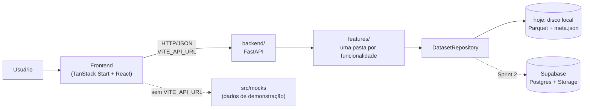

# Arquitetura do DataPulse

## Visão geral



| Parte | Pasta | Papel |
| --- | --- | --- |
| Frontend | `Frontend/` | Landing page e aplicação (dashboard, datasets, importação, explorador). Projeto conectado ao Lovable. |
| API | `backend/` | Recebe arquivos, trata e guarda os dados, serve linhas paginadas e estatísticas. |
| Protótipo | `app.py` | App Streamlit original. Será aposentado quando o Frontend cobrir o mesmo fluxo (Sprint 4). |

O Frontend nunca fala direto com dados: cada feature tem uma pasta `api/` com uma interface e duas
implementações, a HTTP (usa `src/lib/http.ts`) e a de demonstração (usa `src/mocks/`). Com
`VITE_API_URL` definido, as telas usam a API; sem ele, a demonstração (útil no preview do Lovable).

## Hospedagem (decidido)

| Peça | Onde roda |
| --- | --- |
| Frontend e API | **Vercel** |
| Banco de metadados, arquivos e login | **Supabase** (Postgres, Storage e Auth) |

Consequências que guiam o roadmap (`docs/ROADMAP.md`):

- Na Vercel o disco é temporário: os dados não podem ficar em `backend/storage/`. O
  `DatasetRepository` ganha uma versão Supabase (metadados no Postgres, Parquet no Storage).
- A Vercel limita o tamanho do corpo de cada requisição (cerca de 4,5 MB). Arquivos maiores vão do
  navegador **direto para o Supabase Storage** e a API só processa o que já está lá.
- pandas + pyarrow são pesados para uma função da Vercel; o tamanho do pacote é verificado no
  primeiro deploy (Sprint 2), quando ainda é barato trocar de abordagem.
- O Frontend usa Nitro no build; o alvo de deploy precisa ser o da Vercel (hoje o padrão é Cloudflare).
- Migrações do banco ficam em `supabase/` na **raiz** do repositório, nunca em `Frontend/supabase/`,
  que é área gerenciada pelo Lovable.

## Backend em vertical slices

Cada **funcionalidade** é uma pasta com tudo o que ela precisa (rota, regra e contrato), em vez de
espalhar uma funcionalidade por pastas técnicas (`routes/`, `services/`, `schemas/`...).

```
backend/app/
├── main.py                    # monta o app: CORS, erros → HTTP, registra as features
├── shared/                    # o que qualquer feature pode usar
│   ├── config.py              # Settings (variáveis DATAPULSE_*)
│   ├── errors.py              # categorias de erro: NaoEncontrado (404), EntradaInvalida (422), LimiteExcedido (413)
│   └── api_model.py           # base dos contratos (JSON em camelCase)
└── features/
    ├── health/endpoint.py     # GET /api/health
    └── datasets/
        ├── models.py          # Dataset e DatasetMeta (usados por várias fatias)
        ├── errors.py          # DatasetNaoEncontrado, ArquivoInvalido, ArquivoMuitoGrande
        ├── repository.py      # onde os datasets são guardados
        ├── dependencies.py    # entrega o repositório às rotas
        ├── importar/          # POST /upload → endpoint, caso_de_uso, leitura_csv, datas
        ├── listar/            # GET  /
        ├── obter/             # GET  /{id}
        ├── remover/           # DELETE /{id}
        ├── linhas/            # GET  /{id}/rows → endpoint, paginacao
        └── estatisticas/      # GET  /{id}/stats → endpoint, perfil
```

Regras:

1. **Uma fatia não importa outra fatia.** O que duas fatias precisam vai para a raiz da feature
   (`models.py`, `repository.py`...); o que duas features precisam vai para `shared/`.
2. **Contrato mora com quem usa.** `PaginatedRows` só existe em `linhas/`; `ColumnStats` só em
   `estatisticas/`. Sobe para `models.py` quando uma segunda fatia precisar.
3. **Endpoint fino.** O `endpoint.py` traduz HTTP ↔ Python. Regras com mais de poucas linhas
   ficam num módulo ao lado (`caso_de_uso.py`, `paginacao.py`), testável sem HTTP.
4. **Erros por categoria.** Cada erro herda de uma categoria de `shared/errors.py`, que define o
   status HTTP. O `main.py` não conhece erros de nenhuma feature.
5. **Testes espelham as fatias:** `tests/features/datasets/test_importar.py` e assim por diante.

### Como criar uma nova fatia

1. Crie `app/features/<feature>/<fatia>/endpoint.py` com um `router = APIRouter()`.
2. Registre o router no `__init__.py` da feature.
3. Crie `tests/features/<feature>/test_<fatia>.py`.

## Frontend em vertical slices

As rotas em `src/routes/` (exigidas pelo TanStack Start) são **cascas finas**: título da página,
parâmetros da URL e qual componente mostrar. A tela de verdade mora na feature, com as mesmas fatias
do backend:

```
Frontend/src/
├── routes/                     # casca: head + validateSearch + componente da feature
├── features/datasets/
│   ├── types.ts                # contratos (espelham o backend) e regras pequenas (canExplore...)
│   ├── queries.ts              # React Query: chaves de cache e hooks (useDatasets, useRemoveDataset...)
│   ├── api/                    # datasets-api.ts (interface), http-*, demo-*, query-rows (regras da demo)
│   ├── components/             # usados por mais de uma fatia (StatusBadge)
│   ├── listar/                 # tela Meus Datasets
│   ├── importar/               # tela Importar
│   └── explorar/               # tela Explorador
├── components/ui, components/layout   # visual compartilhado (shadcn + layout do app)
├── lib/                        # utilidades sem regra de negócio (http, format, theme)
└── mocks/                      # dados de demonstração
```

Mesmas regras do backend: uma fatia não importa outra (o que é dividido sobe para a raiz da
feature); lógica que dá para testar sem tela fica em `.ts` ao lado do componente
(`filter-datasets.ts`, `rows-query-state.ts`, `preview.ts`), com o teste junto (`*.test.ts`).
Nomes de pastas em português (iguais às fatias do backend); componentes e funções em inglês, como no
restante do código gerado pelo Lovable.

Dashboard, Relatórios e Configurações ainda estão em `routes/` com dados de demonstração e viram
features nos sprints 4 e 5.

## Contrato da API

| Método | Rota | Resposta |
| --- | --- | --- |
| GET | `/api/health` | `{status, version}` |
| GET | `/api/datasets` | `Dataset[]` (mais recentes primeiro) |
| POST | `/api/datasets/upload` | `Dataset` (201). Multipart: `file`, opcionais `description`, `separator`, `encoding` |
| GET | `/api/datasets/{id}` | `Dataset` |
| DELETE | `/api/datasets/{id}` | 204 |
| GET | `/api/datasets/{id}/rows` | `PaginatedRows`. Parâmetros: `page` (começa em 1), `page_size` (máx. 1000), `search` (texto em qualquer coluna), `filters` (JSON `{"coluna": "valor exato"}`), `sort` (coluna), `order` (`asc`/`desc`). `total` conta as linhas filtradas. |
| GET | `/api/datasets/{id}/stats` | `ColumnStats[]`. Colunas `categoria` trazem `values` (opções de filtro). |

Erros esperados respondem `{"detail": "mensagem"}`: 404 (dataset não existe), 413 (arquivo acima
de `DATAPULSE_MAX_UPLOAD_MB`), 422 (arquivo ilegível, vazio, formato não suportado, ou
busca/filtro com coluna inexistente). A
documentação interativa fica em `http://localhost:8000/docs` (a raiz `/` redireciona para lá).

Ao mudar um contrato, altere juntos o modelo Python da fatia e `Frontend/src/features/datasets/types.ts`.

## Fluxo de importação

1. O Frontend valida uma prévia no navegador (Papa Parse, só as primeiras linhas). Arquivos
   `.zip`/`.gz` não têm prévia: vão direto para a API.
2. Ao concluir, envia o arquivo para `POST /api/datasets/upload`.
3. A API copia o upload para `storage/tmp/` respeitando o limite de tamanho, detecta encoding
   (utf-8 → latin-1) e separador (`, ; tab |`), lê com pandas e converte colunas de data.
4. Os dados vão para `data.parquet` (preserva tipos e lê rápido) e os metadados para `meta.json`,
   escritos numa pasta temporária e renomeados, para nunca aparecer um dataset pela metade.
5. Leituras posteriores (linhas, estatísticas) usam um cache LRU dos últimos DataFrames.

Hoje a importação é síncrona e o dataset já nasce `processado`.

## Decisões

- **FastAPI + pandas**: reaproveita o código do protótipo e o ecossistema de dados do Python.
- **Vertical slices**: cada funcionalidade é lida, alterada e testada num lugar só.
- **Repositório como única peça que conhece o armazenamento**: trocar disco por Supabase é uma
  nova implementação com os mesmos métodos, sem mexer nas fatias.
- **Tipos semânticos no backend**: o Frontend recebe `moeda`, `data`, `categoria` etc. prontos.
- **bun no Frontend**: é o gerenciador do Lovable (`bun.lock`); `package-lock.json` é ignorado.
- **Vercel + Supabase**: ver "Hospedagem".

## Próximos passos

Ver `docs/ROADMAP.md`.
