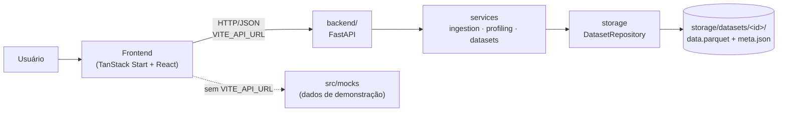

# Arquitetura do DataPulse

## Visão geral



| Parte | Pasta | Papel |
| --- | --- | --- |
| Frontend | `Frontend/` | Landing page e aplicação (dashboard, datasets, importação, explorador). Projeto conectado ao Lovable. |
| API | `backend/` | Recebe arquivos, trata e guarda os dados, serve linhas paginadas e estatísticas. |
| Protótipo | `app.py` | App Streamlit original. Continua funcionando, mas a lógica dele foi levada para `backend/app/services/ingestion.py`; ele deve ser aposentado quando o Frontend cobrir o mesmo fluxo. |

O Frontend nunca fala direto com dados: tudo passa por `Frontend/src/services/` (cliente central
em `http.ts`). Com `VITE_API_URL` definido, chama a API; sem ele, usa os mocks. Assim as telas
podem evoluir antes do backend e continuam iguais depois.

## Backend em camadas

```
backend/app/
├── main.py              # cria o FastAPI, CORS, traduz erros de domínio em HTTP
├── core/
│   ├── config.py        # Settings (variáveis DATAPULSE_*)
│   └── errors.py        # DatasetNaoEncontrado, ArquivoInvalido, ArquivoMuitoGrande
├── api/
│   ├── deps.py          # injeção de dependências (service/repositório)
│   └── routes/          # health.py, datasets.py — só HTTP, sem regra de negócio
├── schemas/datasets.py  # contratos Pydantic (espelham Frontend/src/types, JSON em camelCase)
├── services/
│   ├── ingestion.py     # lê CSV/.zip/.gz, detecta separador, encoding e datas
│   ├── profiling.py     # tipo de cada coluna (texto/número/moeda/data/categoria) e estatísticas
│   └── datasets.py      # casos de uso: importar, listar, paginar, estatísticas, remover
└── storage/repository.py  # persistência em disco (Parquet + JSON) com cache em memória
```

Regra de dependência: `api → services → storage`. As rotas não sabem de pandas e os serviços não
sabem de HTTP — isso permite testar cada parte isolada e trocar a persistência depois.

## Contrato da API

| Método | Rota | Resposta |
| --- | --- | --- |
| GET | `/api/health` | `{status, version}` |
| GET | `/api/datasets` | `Dataset[]` (mais recentes primeiro) |
| POST | `/api/datasets/upload` | `Dataset` (201). Multipart: `file`, opcionais `description`, `separator`, `encoding` |
| GET | `/api/datasets/{id}` | `Dataset` |
| DELETE | `/api/datasets/{id}` | 204 |
| GET | `/api/datasets/{id}/rows?page=1&page_size=25` | `PaginatedRows` (página começa em 1, máx. 1000 linhas) |
| GET | `/api/datasets/{id}/stats` | `ColumnStats[]` |

Erros esperados respondem `{"detail": "mensagem"}`: 404 (dataset não existe), 413 (arquivo acima
de `DATAPULSE_MAX_UPLOAD_MB`), 422 (arquivo ilegível, vazio ou formato não suportado). A
documentação interativa fica em `http://localhost:8000/docs`.

Ao mudar um contrato, altere juntos `backend/app/schemas/datasets.py` e
`Frontend/src/types/index.ts`.

## Fluxo de importação

1. O Frontend valida uma prévia no navegador (Papa Parse, só as primeiras linhas).
2. Ao concluir, envia o arquivo para `POST /api/datasets/upload`.
3. A API copia o upload para `storage/tmp/` respeitando o limite de tamanho, detecta encoding
   (utf-8 → latin-1) e separador (`, ; tab |`), lê com pandas e converte colunas de data.
4. Os dados vão para `data.parquet` (preserva tipos e lê rápido) e os metadados para `meta.json`,
   escritos numa pasta temporária e renomeados, para nunca aparecer um dataset pela metade.
5. Leituras posteriores (linhas, estatísticas) usam um cache LRU dos últimos DataFrames.

Hoje a importação é síncrona e o dataset já nasce `processado`. Os status `pendente`/`processando`
existem no contrato para a fila assíncrona (próximos passos).

## Decisões

- **FastAPI + pandas**: reaproveita o código do protótipo e o ecossistema de dados do Python.
- **Parquet em disco, sem banco por enquanto**: zero infraestrutura para começar. O
  `DatasetRepository` é a única peça que conhece o disco; trocar por Postgres/S3 é uma nova
  implementação com os mesmos métodos.
- **Tipos semânticos no backend**: o Frontend recebe `moeda`, `data`, `categoria` etc. prontos, em
  vez de adivinhar a partir dos valores.

## Próximos passos sugeridos

1. Trocar `useDatasets` e as telas que leem `src/mocks` por `datasetsService` + React Query.
2. Filtro, busca e ordenação no servidor em `/rows` (o explorador hoje faz isso em memória).
3. Endpoints de agregação para o dashboard (KPIs, série mensal, agrupamentos), hoje em
   `Frontend/src/lib/analytics.ts`.
4. Decimal com vírgula (`45,50`) nos CSVs brasileiros: hoje essas colunas ficam como texto.
5. Processamento assíncrono (fila + status `processando`) para arquivos grandes.
6. Autenticação e um usuário por dataset; banco de metadados (Postgres) quando houver vários usuários.
7. Docker Compose com Frontend + API.
